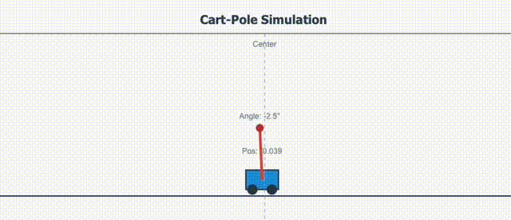

# Multi-Environment Proximal Policy Optimization (PPO)

<p align="center">
   
</p>

This project demonstrates a complete reinforcement learning pipeline using Proximal Policy Optimization (PPO) across **four different physics-based environments**. It includes custom implementations of CartPole, MountainCar, Pendulum, and Acrobot environments, a PPO agent that supports both discrete and continuous actions, and a web-based visualization interface to observe training progress in real-time.

The application allows you to run a pre-trained model in example mode, or train a new model from scratch. It supports multiple model formats including PyTorch, TorchScript, and ONNX, making it flexible for different deployment scenarios. I've also built in a conversion script to convert PyTorch models to ONNX format for use with Qualcomm AI Hub, enabling NPU acceleration on Snapdragon devices.

## Table of Contents
- [Supported Environments](#supported-environments)
- [Quick Start](#quick-start)
- [Environment Selection](#environment-selection)
- [Model Formats](#model-formats)
- [Researcher Notes](#researcher-notes)
   - [PPO Algorithm Details](#ppo-algorithm-details)
   - [Customization with the Configuration File](#customization-with-the-configuration-file)
- [Developer Notes](#developer-notes)
   - [Technical Implementation](#technical-implementation)
   - [Project Layout](#project-layout)
   - [Testing](#testing)
- [License](#license)

## Supported Environments

### 🤖 CartPole (Discrete Actions)
- **Task**: Balance a pole on a moving cart by applying left/right forces
- **State**: Cart position, cart velocity, pole angle, pole angular velocity (4D)
- **Actions**: Left (0) or Right (1) force application (±10N)
- **Episode termination**: Cart position exceeds ±2.4m or pole angle exceeds ±12°
- **Reward**: +1.0 for each step balanced, 0.0 when episode ends
- **Solved**: Average reward of 195+ over 100 consecutive episodes

### 🏔️ Mountain Car (Continuous Actions)
- **Task**: Drive an underpowered car up a steep hill by building momentum
- **State**: Car position, car velocity (2D)
- **Actions**: Continuous force in range [-1, +1] (scaled internally)
- **Episode termination**: Goal reached (position ≥ 0.45) or 999 steps elapsed
- **Reward**: -0.1×action² per step, +100 bonus for reaching goal
- **Solved**: Average reward of 90+ over 100 consecutive episodes

### 🕰️ Pendulum (Continuous Actions) - **MODIFIED**
- **Task**: Swing a pendulum upright from hanging position using continuous torque
- **State**: cos(θ), sin(θ), angular velocity (3D)
- **Actions**: Continuous torque in range [-1, +1] (scaled to ±2.0 max torque)
- **Episode termination**: Fixed horizon of 200 steps
- **Starting position**: Hanging down (θ ≈ π) with small random perturbations
- **Reward**: cos(|θ|) - 0.01×θ̇² - 0.001×u² per step (maximize position reward)
  - Maximum reward (+1.0) when upright (θ = 0)
  - Minimum reward (-1.0) when hanging down (θ = ±π)
  - Smooth continuous increase in either direction toward upright
- **Solved**: Average reward of 0.8+ over 100 consecutive episodes
- **Recommended Settings**: 
  - `ppo`:
      - `learning_rate`: 0.0001
      - `clip_ratio`: 0.1
      - `update_frequency`: 100

### 🤸 Acrobot (Discrete Actions)
- **Task**: Swing a two-link underactuated pendulum to get the end-effector above the first joint level
- **State**: Joint angles θ₁, θ₂ and angular velocities (4D)  
- **Actions**: Apply torque {-1, 0, +1} to the second joint only
- **Episode termination**: End-effector height reaches above first joint level or 500 steps elapsed
- **Reward**: -1.0 per step until goal reached, 0.0 when goal achieved
- **Solved**: Average reward of -100+ over 100 consecutive episodes

## Quick Start
By default, the application runs a pretrained CartPole model in **example mode**. You'll see a real-time simulation with live metrics demonstrating "perfect" balancing behavior without requiring training time.

**To enable model training**, flip the `example_mode` setting under `training` to `false`:

## Environment Selection
Choose which environment to train/run by modifying the `game` section in `config.yaml`:

```yaml
game:
  environment: "cartpole"  # Options: "cartpole", "mountain_car", "pendulum", "acrobot"
```

Each environment has its own:
- **Model save path**: Separate models for each environment type
- **Example model path**: Pre-trained models for demonstration
- **Solved threshold**: Environment-specific success criteria
- **Network architecture**: Automatically configured input/output dimensions

**To enable model training**, flip the `example_mode` setting under `training` to `false`:
```yaml
training:
  # some other settings...
  example_mode: false
  # some other settings...
```

### Prerequisites
Requires either Python 3.8+ with dependencies installed or Docker and Docker Compose. Use the appropriate method in the run instructions below.

### Setup
1. Clone this repository:
   ```bash
   git clone https://github.com/thatrandomfrenchdude/cart-pole-ppo.git
   cd cart-pole-ppo
   ```
2. Configure the environment:
   ```bash
   # python
   python -m venv venv
   source venv/bin/activate  # On Windows use `venv\Scripts\activate`
   pip install -r requirements.txt
   ```

### Run the Tests
Run the tests to ensure everything is working correctly. The tests cover unit tests, integration tests, and performance tests.
1. Install test dependencies:
   ```bash
   pip install -r requirements-test.txt
   ```

2. Run the tests:
   ```bash
   # On Linux/macOS
   chmod +x scripts/run_tests.sh
   ./scripts/run_tests.sh all
   
   # On Windows (PowerShell)
   .\scripts\run_tests.ps1 all
   ```

### Run the Application
1. Run the application server:
   ```bash
   # python
   python main.py

   # docker
   docker-compose up
   ```

2. Open your web browser and go to: `http://localhost:8080`

## Model Formats
The application supports multiple model formats for flexibility:
- **PyTorch**: `.pth` files
- **TorchScript**: `.pt` files  
- **ONNX**: `.onnx` files

For training, the default model format is PyTorch and cannot be changed. In example mode, the model can be in any of the supported formats. The application will automatically detect the format based on the file extension.

### Environment-Specific Model Paths
Each environment has its own model configuration in `config.yaml`:

```yaml
training:
  # Model save paths for each environment
  model_save_paths:
    cartpole: "models/ppo_cartpole.pth"
    mountain_car: "models/ppo_mountain_car.pth"
    pendulum: "models/ppo_pendulum.pth"
    acrobot: "models/ppo_acrobot.pth"
  
  # Example model paths for each environment  
  example_model_paths:
    cartpole: "example/model.pth"
    mountain_car: "example/mountain_car_model.pth"
    pendulum: "example/pendulum_model.pth"
    acrobot: "example/acrobot_model.pth"
```

### Example Models
Examples of all three model formats can be found in the `example` directory:
```example/
├── model.pth        # PyTorch model
├── model.pt         # TorchScript model
└── model.onnx       # ONNX model
```
You can compare the performance of these models by activating the virtual environment and running the `compare_models.py` script:
```bash
# Activate the virtual environment
source venv/bin/activate  # On Windows use `venv\Scripts\activate`

# Run the comparison script
python src/compare_models.py # assumes the working directory is the project root
```

### A Note on Model Conversion
The `aihub_conversion.py` script is provided in the `src` directory to convert .pth models to .pt and .onnx using Qualcomm AI Hub. This provides NPU acceleration for the ONNX model when running on a Snapdragon X device. You can also convert the models on your own if you prefer.

## Researcher Notes

### PPO Algorithm Details

The implementation includes:
- **Policy Network**: Outputs action probabilities (discrete) or action mean/std (continuous)
- **Value Network**: Estimates state values for advantage calculation
- **Shared Feature Extraction**: Common layers for both policy and value functions
- **Clipped Surrogate Objective**: Prevents large policy updates
- **Generalized Advantage Estimation**: Improves learning stability
- **Multi-Environment Support**: Handles both discrete and continuous action spaces

#### Training Process

1. **Environment Reset**: Start new episode with random initial state
2. **Action Selection**: 
   - **Discrete environments (CartPole, Acrobot)**: Policy network outputs action probabilities via categorical distribution
   - **Continuous environments (MountainCar, Pendulum)**: Policy network outputs mean and std for normal distribution, actions clipped to [-1, +1] range
3. **Experience Collection**: Store states, actions, rewards, and probabilities
4. **Policy Updates**: Every 200 steps, update the policy using PPO loss
5. **Performance Tracking**: Log episode rewards and training statistics

#### Performance Expectations

Each environment has different solving criteria:
- **CartPole**: Average reward of 195+ over 100 consecutive episodes (max possible: 200+ per episode)
- **MountainCar**: Average reward of 90+ over 100 consecutive episodes (considers goal bonus minus energy costs)
- **Pendulum**: Average reward of -200+ over 100 consecutive episodes (minimize cost function - closer to 0 is better)
- **Acrobot**: Average reward of -100+ over 100 consecutive episodes (fewer negative steps to lift end-effector above first joint)

Training typically shows improvement within the first few episodes. Complete learning usually occurs within 100-500 episodes depending on environment complexity and initialization. Episodes have the following horizons:
- **CartPole**: Variable length (terminates when pole falls or cart goes out of bounds)
- **MountainCar**: Maximum 999 steps (terminates early if goal reached)
- **Pendulum**: Fixed 200 steps per episode
- **Acrobot**: Maximum 500 steps (terminates early if end-effector raised above first joint level)

### Customization with the Configuration File
The [`config.yaml`](config.yaml) file allows you to customize all aspects of training. There are sections for environment parameters, neural network architecture, PPO hyperparameters, training settings, server configuration, and logging.

#### Environment Selection
```yaml
game:
  environment: "cartpole"  # Choose: "cartpole", "mountain_car", "pendulum", "acrobot"
```

#### Environment-Specific Parameters
Each environment has its own physics parameters. Below are examples for CartPole and Pendulum:

```yaml
# CartPole Environment
environment:
  gravity: 9.8                          # Gravitational acceleration (m/s^2)
  cart_mass: 1.0                        # Mass of the cart (kg)
  pole_mass: 0.1                        # Mass of the pole (kg)
  pole_half_length: 0.5                 # Half length of the pole (m)
  force_magnitude: 10.0                 # Magnitude of force applied to cart (N)
  time_step: 0.02                       # Time between state updates (seconds)
  position_threshold: 2.4               # Cart position limit (m)
  angle_threshold_degrees: 12           # Pole angle limit (degrees)

# Pendulum Environment  
pendulum:
  max_speed: 8.0                        # Maximum angular velocity
  max_torque: 2.0                       # Maximum applied torque
  time_step: 0.05                       # Time between updates
  gravity: 10.0                         # Gravitational acceleration
  mass: 1.0                             # Pendulum mass
  length: 1.0                           # Pendulum length
```

#### PPO Algorithm Parameters
```yaml
ppo:
  learning_rate: 0.0003                 # Learning rate for optimizer
  discount_factor: 0.99                 # Gamma - reward discount factor
  clip_ratio: 0.2                       # Epsilon - PPO clipping ratio
  update_epochs: 4                      # Number of epochs per PPO update
  update_frequency: 200                 # Steps between PPO updates
```

#### Solved Thresholds by Environment
```yaml
training:
  solved_reward_thresholds:
    cartpole: 195.0                     # CartPole: average reward of 195+ over 100 episodes
    mountain_car: 90.0                  # MountainCar: average reward of 90+ (goal bonus - energy costs)
    pendulum: -200.0                    # Pendulum: minimize cost (closer to 0 is better)
    acrobot: -100.0                     # Acrobot: reach target height quickly (lift end-effector above first joint)
```

## Developer Notes

### Technical Implementation

- The implementation uses PyTorch for neural networks with support for both discrete and continuous action spaces
- Flask serves both the API and static files
- The training runs in a separate thread to avoid blocking the web server
- State normalization and advantage estimation improve learning stability
- The visualization polls the backend every 100ms for smooth animation
- Modular architecture allows for easy testing and maintenance
- Environment factory pattern enables easy addition of new environments
- Automatic network architecture configuration based on selected environment

### Project Layout

The project is organized as follows:
```
cart-pole-ppo/
├── scripts/                      # Utility scripts
│   ├── run_tests.sh              # Script to run all tests (Linux/macOS)
│   ├── run_tests.bat             # Script to run all tests (Windows)
│   └── run_tests.ps1             # Script to run all tests (Windows PowerShell)
├── src/
│   ├── visualization/            # Frontend files (HTML, CSS, JS)
│   │   ├── index.html            # Main HTML page
│   │   ├── styles.css            # CSS styles
│   │   └── visualization.js      # JavaScript for visualization and API calls
│   ├── agent.py                  # PPO agent implementation (supports discrete & continuous)
│   ├── aihub_conversion.py       # Model conversion script for Qualcomm AI Hub
│   ├── config.py                 # Configuration file for hyperparameters and settings
│   ├── environments.py           # Multi-environment factory and implementations
│   ├── model_loader.py           # Model loading and inference logic
│   ├── network.py                # Neural network architecture (adaptive)
│   ├── training.py               # Training loop and experience collection
│   ├── utils.py                  # Utility functions (logging, config loading)
│   └── web_server.py             # Flask server and API endpoints
├── tests/                        # Test files
│   ├── conftest.py               # Pytest fixtures and configuration
│   ├── test_agent.py             # Tests for PPO agent (legacy)
│   ├── test_config.py            # Tests for configuration loading
│   ├── test_environments.py      # Tests for multi-environment system
│   ├── test_formats.py           # Tests for model formats and conversions
│   ├── test_integration.py       # Integration tests for end-to-end functionality
│   ├── test_integration_multi_env.py  # Multi-environment integration tests
│   ├── test_main.py              # Tests for main entry point
│   ├── test_model.py             # Tests for model loading and inference
│   ├── test_multi_environment_agent.py  # Tests for multi-environment agent
│   ├── test_multi_environment_network.py # Tests for adaptive network
│   ├── test_network.py           # Tests for legacy network architecture
│   ├── test_onnx_model.py        # Tests for ONNX model compatibility
│   ├── test_training.py          # Tests for training loop
│   ├── test_utils.py             # Tests for utility functions
│   └── test_web_server.py        # Tests for web server and API endpoints
├── config.yaml                   # Multi-environment configuration file
├── docker-compose.yml            # Docker Compose configuration
├── main.py                       # Main entry point (supports all environments)
├── requirements-test.txt         # Test dependencies
└── requirements.txt              # Python dependencies
```

### Testing

```bash
# Install test dependencies
pip install -r requirements-test.txt

# Run all tests
pytest

# Or use the test runner scripts:
# Linux/macOS
./scripts/run_tests.sh all

# Windows PowerShell
.\scripts\run_tests.ps1 all

# Run tests with coverage report
pytest --cov=src --cov-report=html

# Run only unit tests (fast)
pytest -m "not slow and not integration"

# Run with verbose output
pytest -v

# Run specific test file
pytest tests/test_environments.py
```

## License

This project is licensed under the MIT License. See the [LICENSE](LICENSE) file for details.